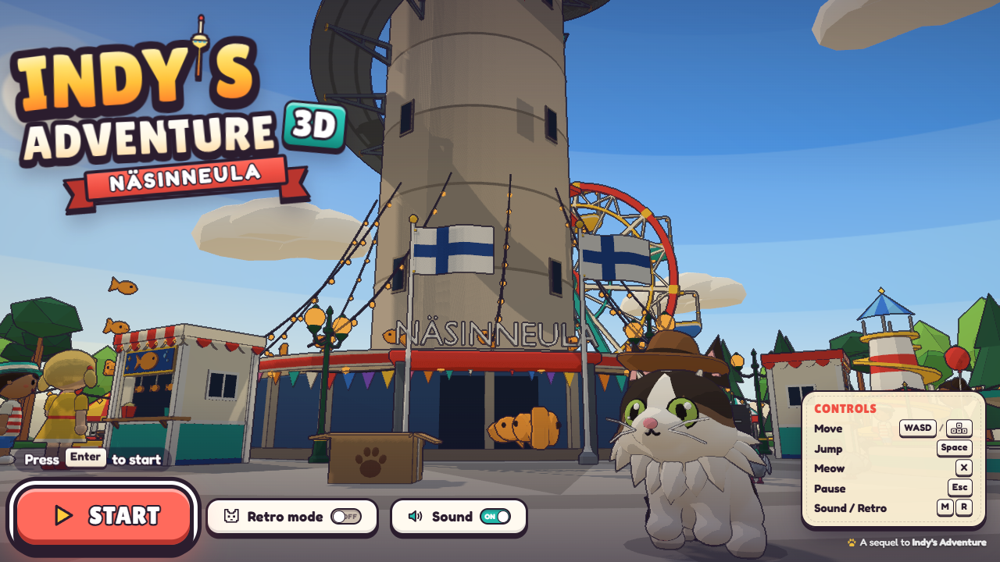
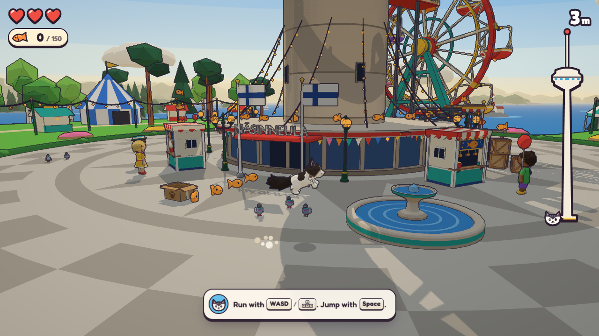
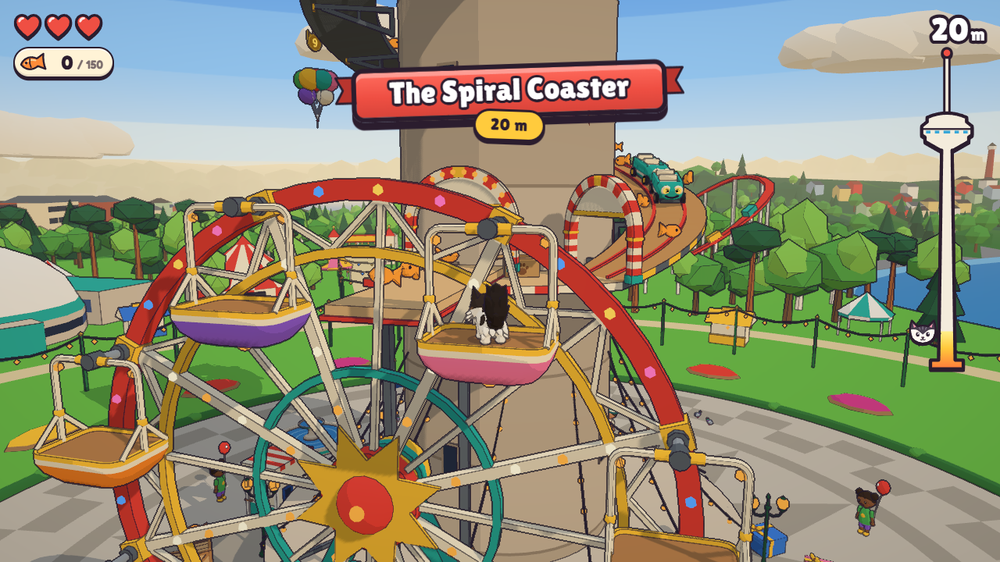
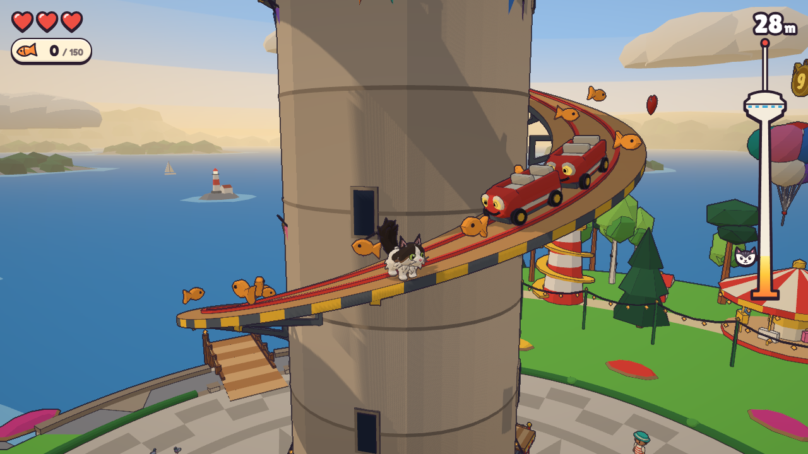
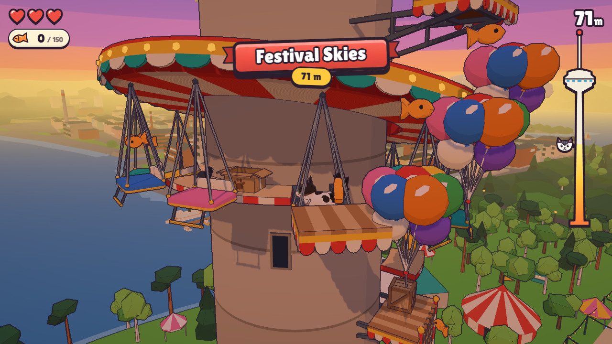
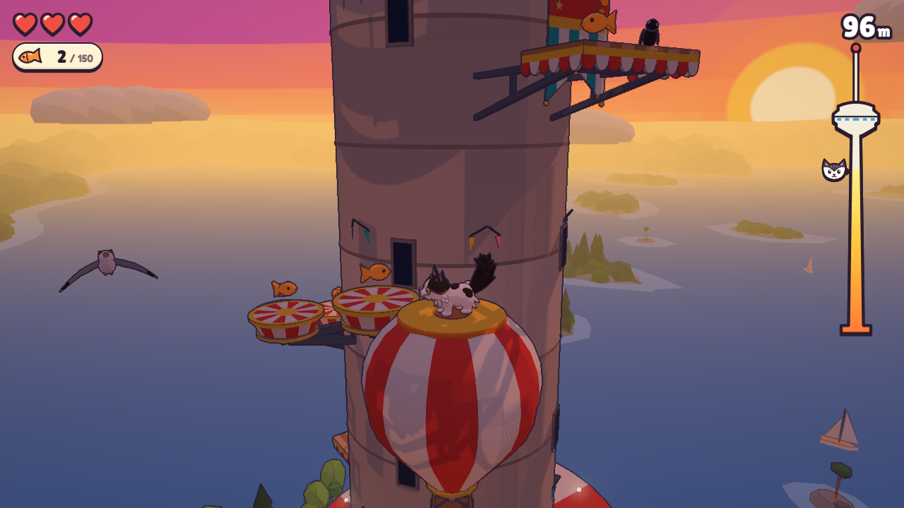
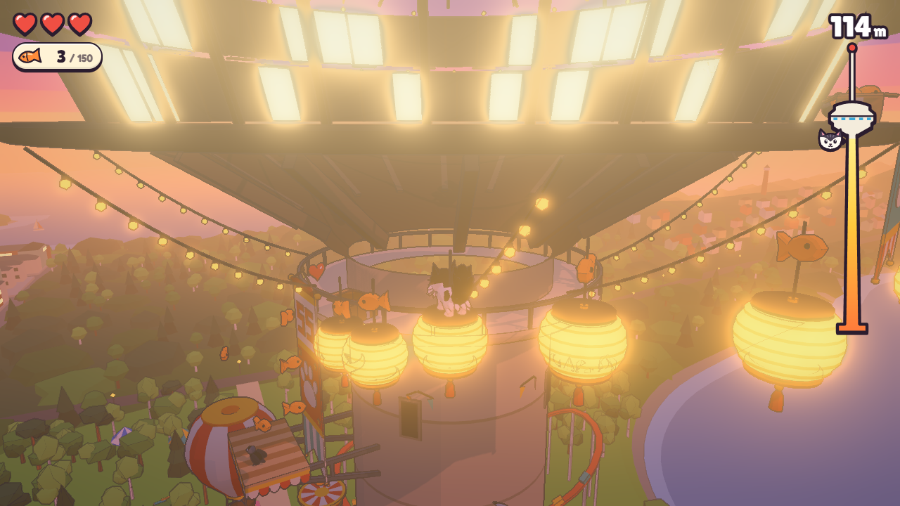
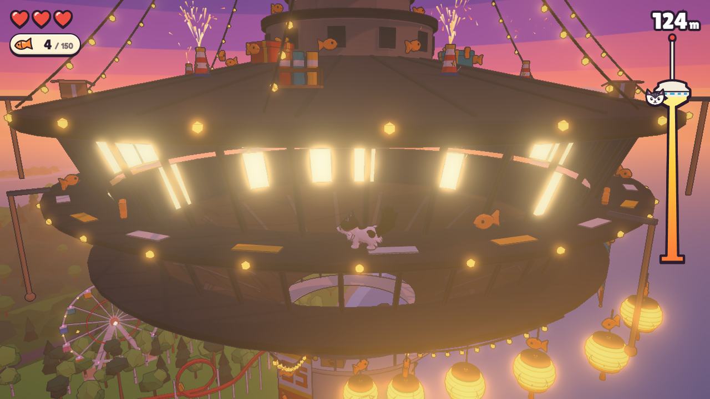
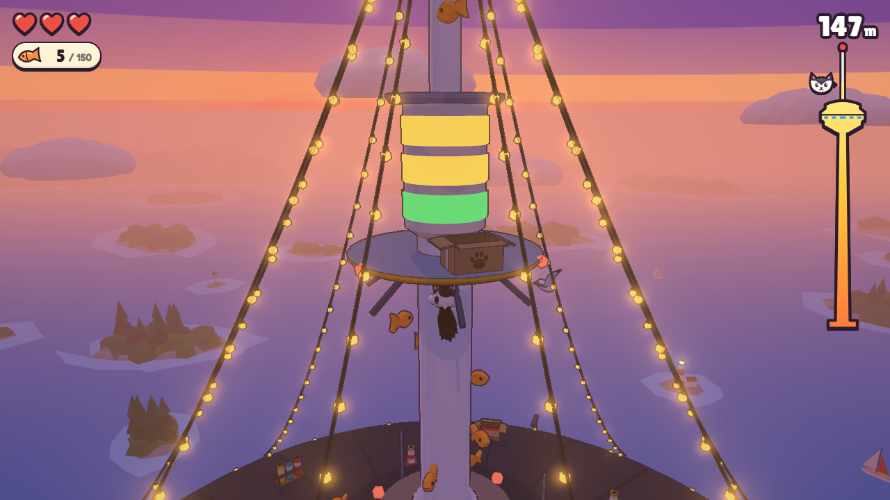
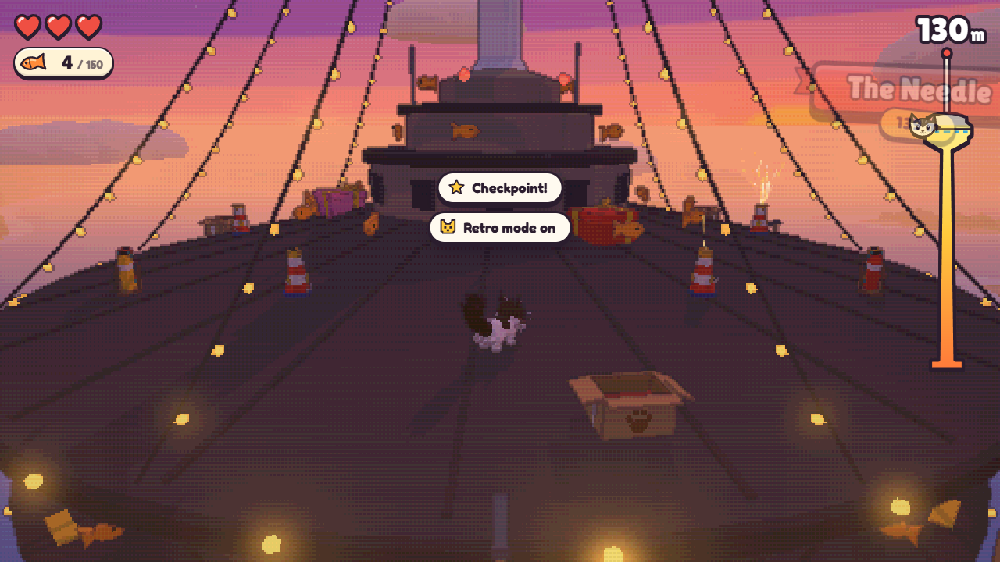

# Indy's Adventure 3D: Näsinneula



Indy (Indiana, for short) is a fluffy white cat with a dark tabby cap and a big dark tail. In
Indy's Adventure he found his way home through Tampere in 2D.
This time he has looked at the Näsinneula, the 168-metre observation tower on the lake shore, and seen what it
really is: the tallest cat tree in Finland. So he climbs it to claim it.

It is one continuous stage on a festival night at the Särkänniemi amusement park. The rides have grown up the
lower half of the tower, festival decorations take over higher up, and the fireworks start when he sits down at the top.
Like the first game it is non-violent: gulls and jackdaws are shooed off with a meow, and visitors say "aww".

## Play

```sh
npm install
npm run dev      # then open http://127.0.0.1:5173
```

`npm run build` makes a static site in `dist/` that works from any path. The included workflow
(`.github/workflows/pages.yml`) builds and publishes it to GitHub Pages on every push to `main`
(set Pages to "GitHub Actions" in the repository settings).

| Action | Keys | Controller | Touch |
| --- | --- | --- | --- |
| Run | WASD or arrows | Left stick or d-pad | Virtual stick |
| Jump (hold for higher) | Space, Z or K | A | JUMP |
| Pounce (a lunge in mid-air) | Jump again in the air | A again | JUMP again |
| Climb a net, ladder, banner, rope or the mast | Push into it; up and down to climb | Stick | Stick |
| Leap off while climbing | Jump | A | JUMP |
| MEOW! | X, J, E or C | X or B | MEOW |
| Pause | Esc or P | Start | Pause button |
| Sound / retro mode | M / R | from the menus | from the menus |

Left and right run around the tower and up and down go toward it or away from it. The camera circles the tower
by itself, so there is nothing else to steer.

## The climb

| | |
| --- | --- |
|  |  |
|  |  |
|  |  |
|  |  |

1. **Särkänniemi Plaza.** Learn to run, jump, climb and meow among kiosks, pigeons and visitors.
2. **The Big Wheel.** Hop into a gondola and ride it to the pier at the top.
3. **The Spiral Coaster.** Run up the track while the coaster cars come down it.
4. **The Drop.** Ride the drop car up, or take the nets if you would rather not.
5. **The Wave Swinger.** Jump onto a swing seat and let it carry you up and around.
6. **Festival Skies.** Balloons, ladders, gusts of wind, a hot-air balloon and a banner for claws.
7. **Under the Saucer.** Lanterns as stepping stones under the pod.
8. **The Revolving Restaurant.** Sparklers on the brim, then a leap for a rope on the revolving tier.
9. **The Needle.** Over the roof, up the mast past the weather beacon, to the tip.

Along the way: 150 fish treats, cardboard-box checkpoints, hearts, and one hidden Nine Lives charm.
The afternoon turns to sunset as Indy gains height, and the music adds layers with it.

Retro mode (R) renders the same game at low resolution with a dithered palette:



## How it is made

- **three.js** with a small custom renderer pipeline: toon shading, ink outlines from a depth-and-normals
  post-process, bloom for the festival lights, and the optional retro pass.
- **Blender** for every model. Each GLB is built by a Python script in `blender/` that runs headless, so the
  assets are reproducible: Indy (sculpted from fused shapes, with a 22-bone rig and ten animations), the tower,
  the rides, the festival props, the birds and visitors, and the Tampere landscape. Colours are flat materials
  from one shared palette; there are no textures.
- **A custom character controller** instead of a physics engine: variable-height jump, coyote time, jump
  buffering, a mid-air pounce, climbing, and riding moving platforms. It runs at a fixed 60 Hz.
- **Synthesized sound.** The music is an adaptive synth-pop score played live with Web Audio: layers fade in as
  Indy climbs and each section has its own groove. The meow is a formant synthesizer. There are no audio files.
- **An HTML overlay** for the HUD, menus and touch controls.

Indy is modelled from photos of the real cat: the white long-haired coat, the dark tabby cap with a white blaze,
the dark patches on his back, the big bushy tail, green eyes and a pink nose. On the title screen he wears a
fedora, because his name is Indiana.

To rebuild a model after editing its script:

```sh
"C:/Program Files/Blender Foundation/Blender 5.2/blender.exe" --background --python blender/indy.py
```

## How it was verified

```sh
npm test            # a bot plays the stage from the plaza to the tip of the mast
npm run test:touch  # a phone-sized run with the touch controls
```

`tests/run.mjs` starts the game in headless Chromium and drives it through the same input path as a player.
The bot in `tests/bot.js` follows the route in `tests/route.js`: it waits for gondolas, swing seats and ropes,
times its jumps between gusts and sparklers, and meows at gulls. The run passes only if Indy reaches the perch
and the page logs no errors. `--each` runs every section on its own from its checkpoint, `--only=festival` runs
one, and `--shots` saves a screenshot per section.

## Project layout

```
index.html              canvas + UI root
src/main.js, game.js    boot, main loop and the game state machine
src/core/               renderer and post-processing, asset loading and toon materials, input, settings
src/world/              collision, player controller, camera, level builder, level layout, movers, entities, sky
src/fx/                 particles and fireworks
src/audio/              adaptive music, sound effects, the meow
src/ui/                 HUD, screens, touch controls
blender/                one Python script per GLB, plus the shared helpers and palette
public/assets/          the exported models
tests/                  the bot, its route, and the touch check
docs/IDEAS.md           level themes set aside for later
```

## Credits

- Idea and direction: Otto. Indy is a real cat.
- Code, models, music and meows: Claude Fable 5.2 (Claude Code), with subagents for the ride and festival kits,
  the creatures, the landscape, the audio engine, the UI and the effects.
- A sequel to Indy's Adventure, which was itself a sequel to The Legend of Tilda.
